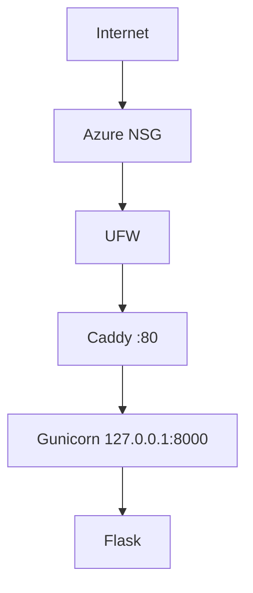
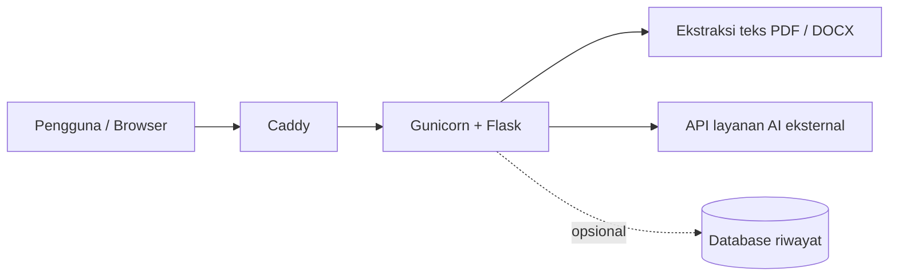

# Architecture v0.1

## Deployment View (M03, sudah berjalan)

## Target Architecture (produk lengkap, bertahap)

Alur: pengguna memasukkan teks atau mengunggah PDF/DOCX, backend Flask memvalidasi
input dan mengekstrak teks, teks dikirim ke API AI, lalu hasil rangkuman ditampilkan
di browser.

## Resource Constraints
- 2 vCPU, sekitar 1 GB RAM, disk 61 GB, swap 1 GB
- Pemrosesan AI dilakukan di layanan eksternal, sehingga tidak membebani VPS

## Security Decisions
- Administrasi memakai user non-root (cloudstudent)
- SSH hanya dengan key; password dan root login dimatikan
- UFW aktif (port 22 dan 80)
- Backend Gunicorn hanya listen di loopback (127.0.0.1:8000)
- Deploy key GitHub khusus satu repository
- API key AI disimpan sebagai environment variable di server, bukan di frontend

## Current Limitations
- HTTP saja, satu VPS, belum ada fitur peringkasan AI
- Belum ada database, container, maupun CI/CD

## Planned Evolution
- M04 DNS + HTTPS
- M05 integrasi AI dan penyimpanan data (riwayat rangkuman)
- M06 container
- M07 infrastructure as code
- M09 CI/CD
